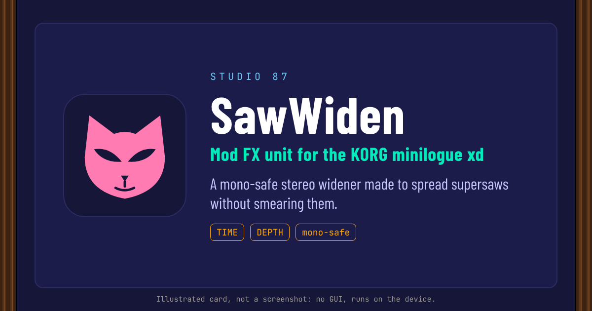
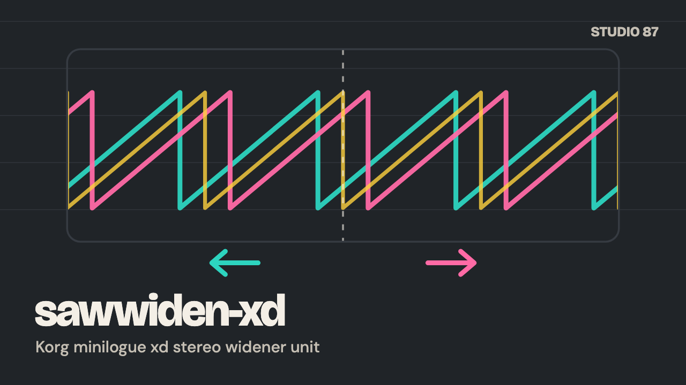

# SawWiden · minilogue xd mod FX

A mono-safe stereo widener for the KORG minilogue xd, made to spread supersaws without smearing them.
The dry center is never touched: a moving "side" signal is added to the left and subtracted from the right, so if you sum to mono the effect cancels out cleanly. No phasing, bass stays centered.

**Download:** [`dist/sawwiden.mnlgxdunit`](dist/sawwiden.mnlgxdunit) · version 1.0

## Install
1. Open **KORG minilogue xd Sound Librarian** and connect the xd by USB.
2. Drag `sawwiden.mnlgxdunit` into a free **User Mod FX** slot.
3. Send to the synth.
4. On the xd: **Effects → MOD → USR → SawWiden**.

## Controls
| Control | What it does |
|---|---|
| TIME | Movement speed, about 0.05 Hz (slow drift) to about 4 Hz (lively shimmer) |
| DEPTH | Width (lowest = dry, highest = very wide) |

SawWiden has no custom parameters (the xd's own mod FX TIME and DEPTH knobs do the work), so there is no one-higher display to worry about.

Made to pair with [HyperSaw](https://github.com/SpeakingColors/hypersaw-xd).

## How it works
Two delay taps (up to ~42 ms) are moved by 3-phase LFOs, string-ensemble style. The result is high-passed so low end stays in the middle, then used as the side signal.

## Status
- Version 1.0, pre-release on GitHub. The unit in `dist/` was built from this repo's source.
- No test on a real minilogue xd is recorded in this repo yet. Linux install steps are not tested yet.
- Docs: [web page](docs/index.html), [INSTALL.txt](packaging/INSTALL.txt), generated by `python3 tools/gen_docs.py` from `manifest.json` and `docs/unit-docs.json`.

## Build from source
1. Clone the [KORG logue SDK](https://github.com/korginc/logue-sdk) (v1) and install its toolchain.
2. Copy this repo's folder into `logue-sdk/platform/minilogue-xd/sawwiden`.
3. Run `make install` in that folder. It builds `sawwiden.mnlgxdunit`.

## License
MIT for our code; KORG SDK template files keep their BSD 3-Clause license. See [LICENSE](LICENSE).

Not affiliated with or endorsed by KORG. "minilogue" is used only to say which synth this works with.

## Support

  

☕ Free and open source, made by one person. If it helps your music, a coffee on [Ko-fi](https://ko-fi.com/studio87) keeps it coming. 💜
